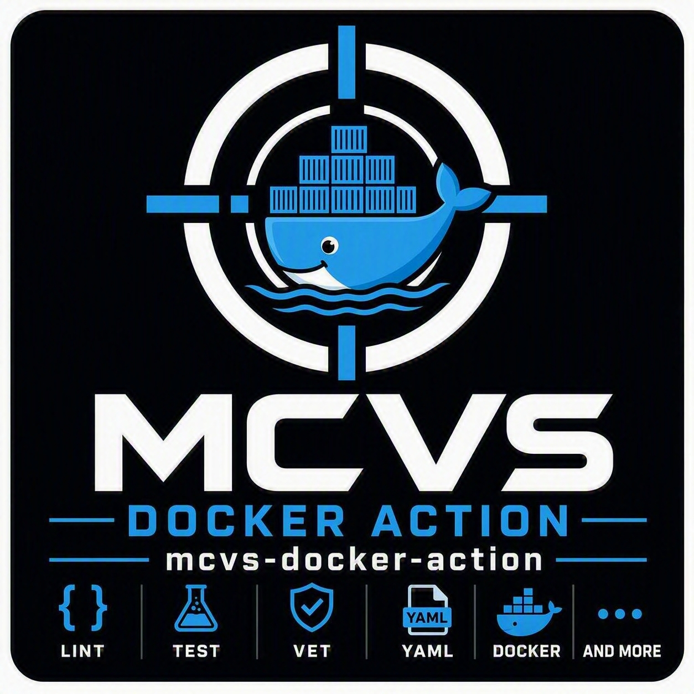

# MCVS Docker Action

[](https://github.com/schubergphilis/mcvs-docker-action/releases)
[](LICENSE)



Mission Critical Vulnerability Scanner (MCVS) Docker Action is a comprehensive GitHub Action that provides a complete Docker image security and quality validation pipeline. This action combines multiple industry-standard tools to ensure your Docker images meet security and quality standards before deployment.

## Quickstart

Create a `.github/workflows/docker.yml` file in your repository:

```yaml
---
name: Docker
on:
  push:
    branches: [main]
    tags: ["v*"]
  pull_request:
    branches: [main]

permissions:
  contents: read
  packages: write

jobs:
  build:
    runs-on: ubuntu-24.04
    steps:
      - uses: actions/checkout@v4
      - uses: schubergphilis/mcvs-docker-action@v0.1.0
        with:
          token: ${{ secrets.GITHUB_TOKEN }}
```

## Documentation

- [Features](docs/features.md)
- [Usage Examples](docs/usage-examples.md)
- [Input Parameters](docs/inputs.md)
- [Security Scanning](docs/security-scanning.md)
- [Image Push Behavior](docs/image-push.md)
- [Troubleshooting](docs/troubleshooting.md)
- [Contributing](docs/contributing.md)
